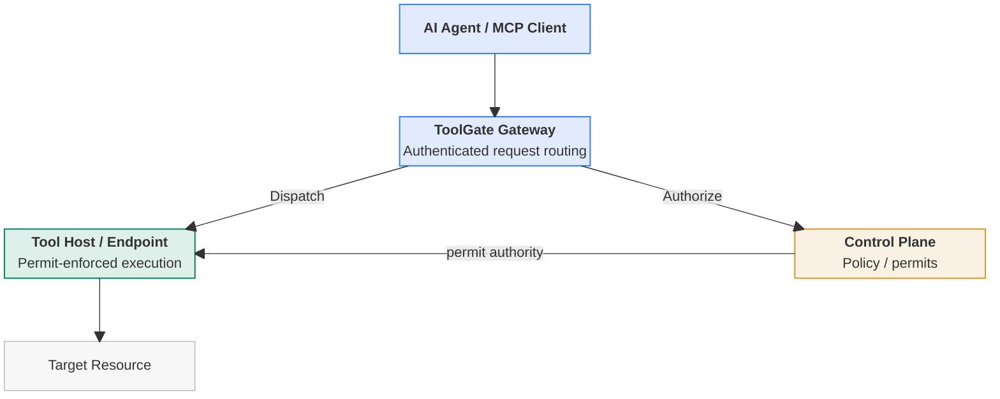
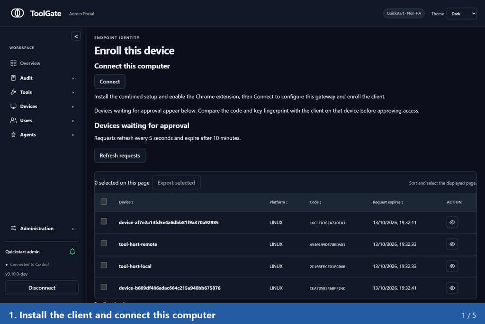
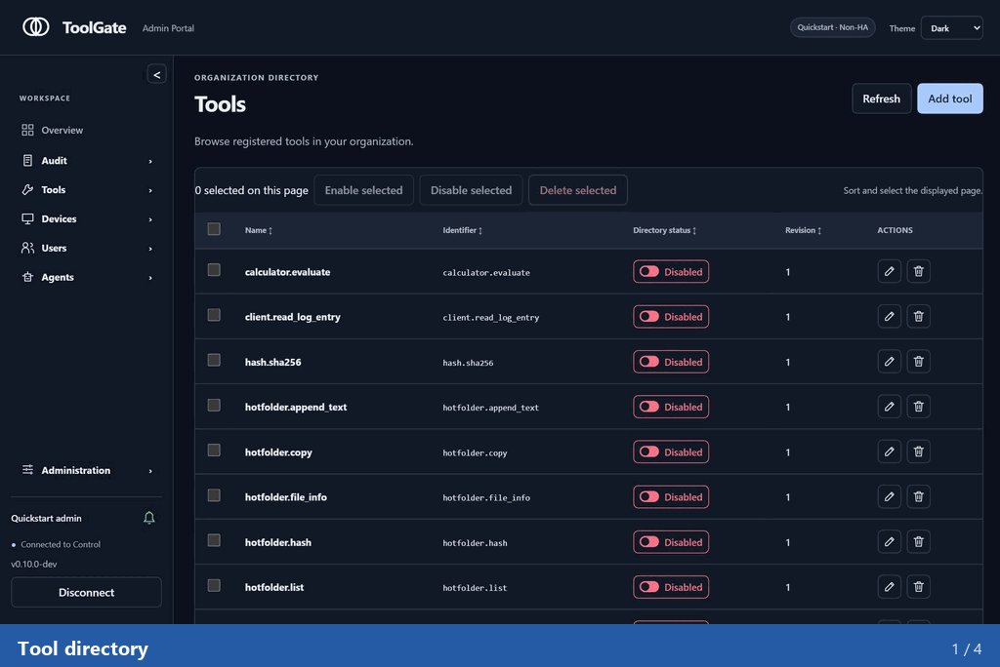
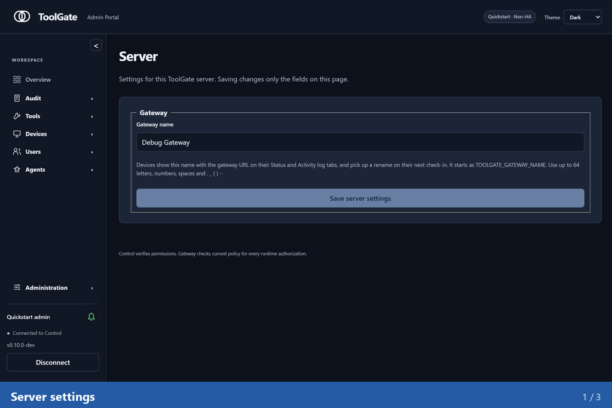
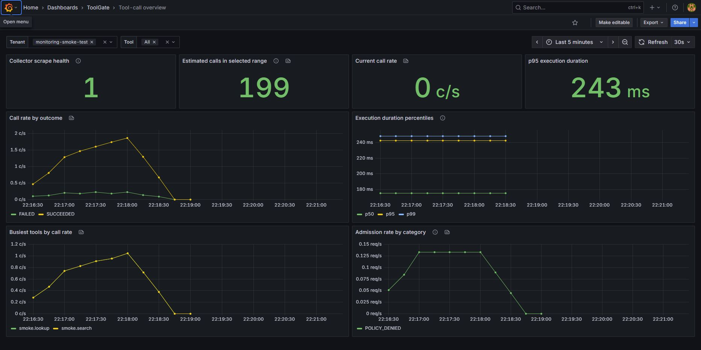
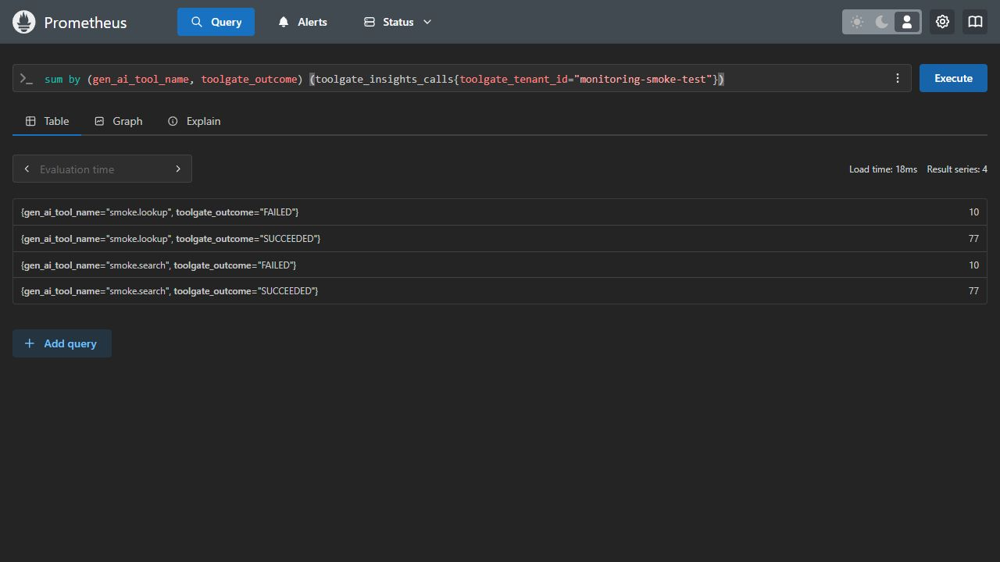
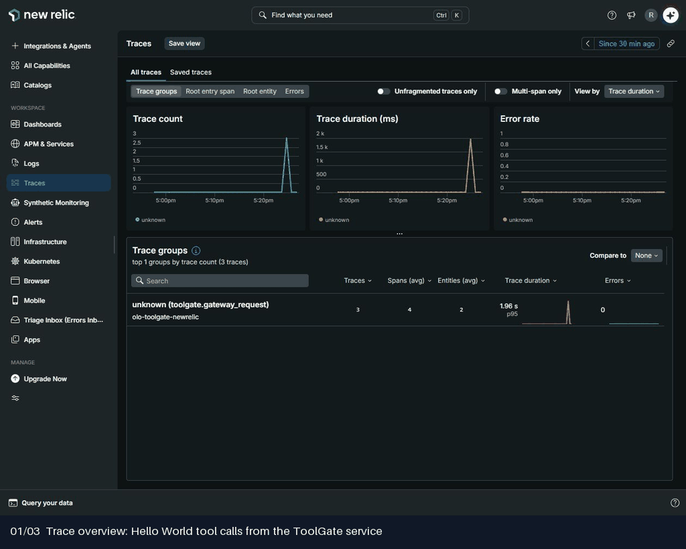

# OLO ToolGate

> **Zero Trust for Agentic AI.**
> **Secure Every Tool Boundary.**

OLO ToolGate is an open-source, self-hosted security gateway for AI agents, MCP
servers and tool execution.

Enforce identity, least-privilege access, runtime authorization, human approvals and
auditable execution at every governed tool boundary.

**Status:** ToolGate is in Beta Release.

**Version and channel:** see this branch's [version configuration](version.json) and the
[published releases](https://github.com/olo-labs/olo-toolgate/releases). For deployment
readiness, see [current limits](#production-and-security-status).

[Quickstart](#quickstart) · [Documentation](docs/README.md) ·
[Security model](docs/security/README.md) ·
[Enterprise evaluation](docs/enterprise-access-control/README.md) ·
[Build a tool](TOOL-SDK-GUIDE.md) · [Contribute](CONTRIBUTING.md)

## Why ToolGate

AI agents act through tools: they write files, call APIs and change systems. Each
tool call crosses a trust boundary. ToolGate sits on that boundary and decides, at
the moment of the call, whether it may proceed. The executor cannot act without
that decision.

- **Verified identities.** Each call is checked against the identities that apply
  to it: the calling agent or workload, the human it acts for when there is one, and
  the executor (an enrolled device or a Tool Host). New users and agents start
  disabled; device approval alone never grants access.
- **Policy at every call.** ALLOW, ASK or BLOCK is evaluated against current
  authority before any protected effect. ASK routes the call to independent human
  approval.
- **Least privilege by default.** Fresh installations grant nothing. Access comes
  only from explicit group grants, delegated scopes and execution bindings.
- **Enforced at the executor.** Executors run a call only under a single-use permit
  from Control, consumed online. If Control is unavailable, nothing runs; cached
  metadata never authorizes offline execution.
- **End-to-end auditability.** Requests, approvals, decisions and outcomes are
  recorded per tenant and correlated to the identities involved.

## Quickstart

Quickstart is a local, single-node evaluation. It runs Control, Gateway, the console
and local execution in one container with SQLite.

**Prerequisites:** Docker with Compose, and Git.

```bash
git clone https://github.com/olo-labs/olo-toolgate.git
cd olo-toolgate/deploy/compose/QuickStart
sh manage.sh deploy        # Windows: .\manage.ps1 deploy
```

The helper creates `.env` from `.env.example` on first run and keeps the data volume
across restarts. The default image, `ololab/olo-toolgate-quickstart:dev`, is a mutable
development tag, so its version can change between deployments; check the
version and build on the console's **About** page after deployment. For a
reproducible evaluation, copy `.env.example` to `.env` first and set `QUICKSTART_IMAGE`
to a versioned tag or an image digest (`ololab/olo-toolgate-quickstart@sha256:…`); see
[development releases](docs/development/development-releases.md).

**What you get:** the console at `http://localhost:8080/console/`, with separate
`admin`, `reviewer-1` and `reviewer-2` accounts. Their generated passwords are in the
container's private `/data/credentials.json`; see [first login](docs/getting-started/first-login.md).

**What you still do:** a fresh installation runs nothing. Tools and the local agent
start disabled with zero runtime rights, by design. Follow
[your first tool](docs/getting-started/first-tool.md) to enroll a device, grant
access and make a governed call. The full walkthrough is in the
[Quickstart guide](docs/getting-started/one-minute-quickstart.md).

## Architecture

The call and the authorization travel separate paths. Gateway dispatches the call;
Control decides and issues the permit; the executor will not act until it redeems
that permit with Control.



Control never forwards calls, and Gateway never signs permits or authorizes from a
cached policy. See [architecture](ARCHITECTURE.md),
[core data flows](docs/architecture/data-flows.md) and
[trust boundaries](docs/architecture/trust-boundaries.md).

## Capabilities

| Capability | What it does | Status |
|---|---|---|
| [MCP governance](docs/gateway/mcp-proxy.md) | Put existing MCP servers behind ToolGate policy, approval and audit without changing them | Available |
| [Runtime policy](docs/security/README.md) | ALLOW / ASK / BLOCK on every tool invocation, against current authority | Available |
| [Delegated authority](docs/security/enterprise-access-control.md) | Constrain what an agent may do on behalf of a person or another agent | Available |
| [Zero-trust execution](docs/control-plane/approvals.md) | Single-use, Control-signed permits checked at the execution boundary | Available; Tool Host container/network isolation unfinished ([#230](https://github.com/olo-labs/olo-toolgate/issues/230)) |
| [Human approval](docs/control-plane/approvals.md) | Independent review of sensitive calls before they run | Available |
| [Tool distribution](docs/client/package-deployment.md) | Package, version and deliver signed tools to devices and Tool Hosts | Available; Java and Python authoring; TypeScript [#242](https://github.com/olo-labs/olo-toolgate/issues/242) and .NET [#243](https://github.com/olo-labs/olo-toolgate/issues/243) are specifications |
| [Audit and analytics](docs/control-plane/insights.md) | Correlate identities, decisions and outcomes; tenant Analytics and Operator Insights | Available |

### Governing an MCP server in five steps

1. **Register** the server's HTTPS URL, credential and Tool Host pool. Control contacts nothing.
2. **Scan.** A Tool Host lists the server's tools; Control stores an immutable snapshot with a digest per tool.
3. **Approve** the tools to expose. ToolGate packages them, and each starts disabled.
4. **Grant** them to agent groups like any other tool, under ALLOW / ASK / BLOCK policies.
5. **Execute and audit.** Agents call through the Gateway. The Tool Host runs each call under its
   permit, validates the arguments and connects with the approved key pins; every call is recorded.

Details: [MCP proxy guide](docs/gateway/mcp-proxy.md).

## See it work

<p align="center">
  
</p>

**Audit, approvals and tool calls.** A live remediation call waits on an `ASK`
policy, an independent reviewer checks the exact invocation, and the approved call
resumes through ToolGate into its outcome, audit trail and Analytics. The example
uses Qwen2.5 7B through Ollama; scripted acceptance traffic is labelled.

> 💡 **Tip:** For individual, high-resolution step frames or manual navigation, browse the
> [Step-by-Step Tour Guide](docs/media/TOURS.md). Every snapshot is in the repository:
> console and operator screens in [`docs/media/screenshots`](docs/media/screenshots) and
> device/client captures in [`docs/media`](docs/media).

<details>
<summary><strong>💻 Devices and device client</strong>: enroll, verify and approve a device</summary>
<br>

<p align="center">
  
</p>

**What to look for in the loop:**

- 💻 The device client opening from the tray and reporting its status.
- 🔑 Enrollment pausing until an administrator compares the key fingerprint.
- ✅ The approved device connecting, with its details and activity log.
- 🗂️ Devices, device groups, device evidence and packages in the console.

Earlier enrollment/client captures are labelled in the tour guide.

</details>

<details>
<summary><strong>🧰 Tools and delegated access</strong>: least privilege from tool to execution binding</summary>
<br>

<p align="center">
  
</p>

**What to look for in the loop:**

- 🧰 Tools built, packaged and grouped, with resource extractors.
- 🤖 Agents, agent groups and workload identities.
- 🤝 Human and agent delegations constraining what an agent may act on.
- 📜 Grants, ALLOW / ASK / BLOCK policies and execution bindings.
- 🔍 Access simulation showing the final decision before anything runs.

</details>

<details>
<summary><strong>⚙️ Workspace administration</strong>: people, identities and server settings</summary>
<br>

<p align="center">
  
</p>

**What to look for in the loop:**

- 🔐 Tenant sign-in and the workspace overview, in dark and light themes.
- 👥 Users, teams, typed roles and human identities.
- 🔌 MCP servers and server settings.
- 💾 Backup/restore, the local vault and the About page.

</details>

Screens were captured from a local `0.10.0-dev` installation on October 27, 2026.
Enabled tools and grants are fictional demo configuration, not installation defaults.

### Observability: Grafana, Prometheus and New Relic

ToolGate exports OpenTelemetry traces and metrics through a collector, so the same
gateway request, authorization, dispatch and Tool Host execution data can be explored
in your own monitoring stack. Ready-to-run stacks:
[Prometheus and Grafana](deploy/prometheus/README.md) and
[New Relic](deploy/newrelic/README.md); see also [Insights](docs/control-plane/insights.md).

<details>
<summary><strong>📊 Grafana</strong>: ToolGate tool-call overview dashboard</summary>
<br>

<p align="center">
  
</p>

The bundled **Tool-call overview** dashboard, filterable by tenant and tool: call
volume and rate, call rate by outcome, p50/p95/p99 execution duration, busiest tools
and admission rate by category (for example `POLICY_DENIED`).

</details>

<details>
<summary><strong>🔥 Prometheus</strong>: ToolGate metrics</summary>
<br>

<p align="center">
  
</p>

The same metrics queried directly in PromQL: `toolgate_insights_calls` summed by
tool name and outcome for one tenant.

</details>

<details>
<summary><strong>🔭 New Relic</strong>: distributed traces of a governed tool call</summary>
<br>

<p align="center">
  
</p>

**What to look for in the slides:**

- 🔭 **Trace overview:** traces from the `olo-toolgate-newrelic` service for a Hello World call.
- 🪜 **Call waterfall:** gateway request, authorization, dispatch and Tool Host execution spans.
- 🏷️ **Execution attributes:** correlation attributes linking the span to the ToolGate execution.

Full-resolution frames: [overview](docs/media/screenshots/newrelic-traces-overview-full.jpg),
[waterfall](docs/media/screenshots/newrelic-call-waterfall-full.jpg) and
[attributes](docs/media/screenshots/newrelic-execution-attributes-full.jpg).
More captures: [New Relic capture notes](docs/media/screenshots/newrelic-captures.md).

</details>

## Production and security status

ToolGate is in Beta Release. The authorization path described above is
enforced today; the following are **not yet** in place:

- **Tool Host isolation:** process launch and broker checks exist, but container
  and network isolation are unfinished. Enhancement: [#230](https://github.com/olo-labs/olo-toolgate/issues/230).
- **Execution recovery:** Tool Hosts have renewable execution leases, an admission
  spool and a durable result outbox ([operator guide](docs/operations/execution-leases.md)).
  Per-effect authorization, consent, target fencing and operation-wide recovery
  remain unfinished: [#230](https://github.com/olo-labs/olo-toolgate/issues/230)
  ([claim inventory](docs/security/zero-trust-execution-status.md)).
- **Offline protected effects:** unsupported; live Control authority remains
  required. Design review: [#239](https://github.com/olo-labs/olo-toolgate/issues/239).
- **Nested or dynamic groups:** unsupported. Enhancement: [#240](https://github.com/olo-labs/olo-toolgate/issues/240).
- **Quickstart:** single-node evaluation software with no HA guarantee.
  Production HA qualification: [#241](https://github.com/olo-labs/olo-toolgate/issues/241).
- **Authoring:** Java and Python implementations are available; TypeScript and .NET
  authoring APIs remain specifications. Implementations: TypeScript [#242](https://github.com/olo-labs/olo-toolgate/issues/242)
  and .NET [#243](https://github.com/olo-labs/olo-toolgate/issues/243).

Recorded acceptance and performance results apply to the tested revision and
environment; they do not establish your deployment's readiness, capacity or
compliance. [Standards alignment](docs/enterprise-access-control/standards-alignment.md)
describes design relationships, not a certification.

Before production, read the [enterprise evaluation guide](docs/enterprise-access-control/README.md),
[threat model](docs/security/threat-model.md) and
[production deployment](docs/deployment/production.md). For multiple tenants, see
[multitenant deployment](docs/deployment/multitenant.md).

The OLO Marketplace is developed in a separate private repository and hosted at
[olo-labs.org](https://olo-labs.org). Control can import from it through the
[Marketplace integration](docs/control-plane/marketplace-integration.md).

## Developers and contributors

| You want to | Start here |
|---|---|
| Build and package a tool | [Tool SDK guide](TOOL-SDK-GUIDE.md) · [Java SDK](tool-sdk/java-sdk/README.md) · [examples](examples/README.md) |
| Govern an existing MCP server | [MCP proxy guide](docs/gateway/mcp-proxy.md) · [example](examples/mcp-proxy/README.md) |
| Run server-side tools | [Tool Host](apps/tool-host/README.md) |
| Build from source | [Development guide](docs/development/README.md) |
| Contribute | [CONTRIBUTING.md](CONTRIBUTING.md) · [architecture map](docs/architecture/component-map.md) |

Small fixes, tests, documentation and examples are welcome. Discuss larger work in
GitHub issues.

## Project resources

[Support](SUPPORT.md) · [Report a vulnerability](SECURITY.md) ·
[Governance](GOVERNANCE.md) · [Code of conduct](CODE_OF_CONDUCT.md) ·
[Changelog](CHANGELOG.md) · [Apache-2.0 license](LICENSE)
